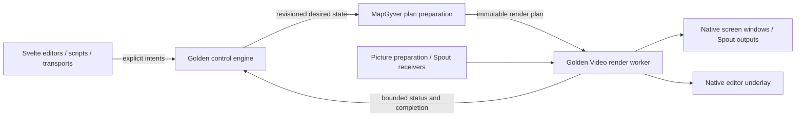

# MapGyver architecture

MapGyver is a video mapping application alongside Chataigne, using the same Golden Core,
workbench, parameter system, scripting, transport, and persistence foundations. Its first target
is Windows x64 (`x86_64-pc-windows-msvc`). This initial design is dated 2026-10-27;
the application and proposed packages below are **not implemented**. Execution belongs to the
[MapGyver plan](../plan/MapGyver_Implementation_Plan.md) and its
[status ledger](../progress/mapgyver-status.md).

## Ownership

MapGyver owns media authoring, projection mapping, Matrix behavior, and its four specialized
editors. Golden owns reusable execution and presentation mechanisms.

| Boundary | Responsibility |
| --- | --- |
| `apps/mapgyver/src/app/` | Thin shell: lifecycle, app identity, node registration, default Media/Screen managers, Golden runtime startup |
| `apps/mapgyver/systems/media/` | Media/channel definitions, source references, composition authoring, backend intents, integration nodes, Rust-owned DTOs |
| `apps/mapgyver/systems/screen/` | Screen/surface definitions, crop/pin/calibration authoring, output policy, backend intents and integration nodes |
| `apps/mapgyver/systems/matrix/` | Cells, layers, groups, columns, transitions, exported channels, app associations and demand policy |
| `apps/mapgyver/ui/` | Svelte 5 Screen, Surface Source, Composition and Matrix editors; app registrations and focused editor stores |
| `crates/golden_video/` (proposed) | App-neutral texture resources, immutable render plans, GPU compositor operations, Spout adapters, presentation, timing and recovery |
| `packages/golden-video-ui/` (proposed) | Reusable native preview registration, geometry and capability bindings; no mapping policy |
| Existing Golden Core hosts and Golden UI | Shared desktop/headless startup, native window integration, workbench, inspectors, history, dialogs, generated transport and persistence |

Media, Screen, Surface and Matrix product nodes never live in `golden_*`. Neither Golden Video
nor Golden UI imports MapGyver or Chataigne. MapGyver does not import Chataigne modules or its
Alchemist/state-machine systems. Golden Video follows the independent Golden Audio pattern:
no Tauri, app-node, or mutable engine dependency; Windows/COM/Spout implementation details stay
behind its public contracts. Use existing Golden identity/time/resource contracts where available.

The filesystem sketch above names responsibility boundaries, not a requirement to create one
crate per folder. Keep cohesive app systems in the app crate until an exercised public consumer
justifies a separate crate. Integration nodes belong beside their system in `integration/`.

## Media and channels

The Media Manager contains reusable media definitions. Every media exposes one or more channels;
each channel is a concurrently available video texture with its own extent. Multiple consumers
of the same channel share its rendered resource, rather than re-rendering that media per surface.

| Media type | Initial behavior | Channel ownership |
| --- | --- | --- |
| Solid Color | Authored color/alpha and output size | User-configured channels, with independent settings |
| Picture | Image assets, worker-side decode and GPU upload | User-configured channels, each with its own picture and size policy |
| Shared Texture | Receive Spout textures | One configured sender per channel; all channels receive concurrently |
| Composition | Ordered 2D instances of other media channels | Authored output canvas/channel definitions; one output by default |
| Matrix | Resolume-style cells, layers, nested groups, transitions and blend modes | Automatically derived channels for layers, groups and final composition |

Spout channels are independent receivers, **not** alternatives in a fallback list. Selecting a
sender for one channel never replaces another channel's sender. Sender discovery is runtime
metadata; persist the configured sender name/selector, not a native sharing handle.

A source reference is the typed pair `(MediaId, ChannelId)`. Channel IDs remain stable through
rename, reorder, size changes, disconnect/reconnect, and resource recreation. Array indices and
labels are never identities. Matrix channels derive their persistent identity from the owning
layer/group/final-output identity. Removing a channel leaves an explicit missing reference;
consumers never silently switch to another channel. Undo/reload restores the authored identity.

Each channel has an authored size policy, either `Automatic` or `Fixed { width, height }`, and a
separate observed resolved extent/status. Automatic uses picture/Spout source metadata, an
authored composition canvas, or the Matrix canvas for derived Matrix outputs. A source without
an intrinsic extent uses an explicit backend default; Solid Color starts with a backend-defined
canvas extent. An absent source is unresolved, not a zero-sized texture. Fixed sizes resample the
source using a declared fit/filter policy. Validate finite dimensions, device limits and memory
budgets before allocation. Source resizing changes the resource generation, not the channel ID.

Composition instances reference media channels without taking ownership of their media. Each
instance has position, scale, rotation, pivot, opacity, blend mode and draw order. Moving or
duplicating an instance does not duplicate its source. Cropping for a Surface belongs to that
Surface, not to the shared source. Composition and Matrix dependencies form a directed acyclic
graph: reject direct or indirect feedback, including a Matrix cell referencing that Matrix's
own exported output. Removing dependencies and undo/redo use the same validation boundary.

Movie-file playback, audio, effects/plugin hosting, mesh warping and edge blending are not part
of this initial feature list. Add them as explicit later scope rather than assuming that
"video mapping" implies a decoder or audio transport in the first delivery.

## Control and rendering



The engine owns authored state, validation, atomic edits, history and coordination. Worker-side
preparation resolves media dependencies and assets, validates the GPU resource budget, and
compiles a revisioned render DAG. The renderer owns GPU resources and frame cadence. No image
decode, GPU wait, Spout discovery, process launch, or per-frame polling runs in engine callbacks.
Windows UI/COM operations stay on their required host thread; rendering never blocks its message
pump waiting for a frame or worker cleanup.

Golden Video consumes generic passes: clear/fill, sampled textured quad, affine composition,
projective quad, blend, offscreen target and output presentation. It does not consume Matrix
columns or MapGyver nodes. A changed parameter or dependency invalidates affected preparation;
do not rebuild the entire engine snapshot or every media output on each frame or pointer move.

Start with a private D3D11 backend, using maintained Windows bindings and a vetted upstream
Spout SDK binding. This is the recommended Windows-first design, subject to the native spike;
it is not a commitment to a second cross-platform backend or an abstract universal graphics API.
Spout's native D3D11 texture API avoids adding D3D12/Vulkan sharing as an initial prerequisite.
The rationale and primary sources are in [native rendering research](mapgyver-native-rendering.md).

The native path must avoid recurring CPU readback/upload. GPU copies, format conversion and
one-time picture uploads are valid and measured. Start on one explicitly identified render
adapter; report incompatible senders/outputs instead of silently moving one receiver to another
device. Cross-adapter support needs separate qualification.

Use explicit pixel format, color-space and alpha contracts. Proposed initial contract: BGRA8/RGBA8
sources, linear-light compositing with premultiplied internal alpha, and explicit input/output
conversion; do not infer a sender's alpha convention from its DXGI format. Qualify normal,
add, multiply and screen blend equations, alpha edges and picture/Spout parity before expanding
the supported format set. HDR and wide-gamut output are later scope.

Plans and completions carry project epoch, plan revision and resource generation. Install
prepared generations at a frame boundary; old GPU resources retire only after their final use
completes. Coalesce superseded desired plans, while retaining reliable command outcomes and
unload completion. Bound in-flight preparation, textures, preview registrations, events and
retiring generations; rejected admission returns an explicit error without partial live changes.

Use the reusable monotonic production-time boundary for transitions and scheduled activation.
Monitor presentation rates and sender arrival do not define show time. A slow output must not
stall all outputs or the control engine. Independent displays are not implicitly genlocked.
The current Chataigne ledger still marks P14 time and P15 assets unimplemented: implementing
MapGyver must exercise those shared boundaries once, rather than invent competing app-local
clocks, file identities or cache protocols. The MapGyver plan names the required acceptance.

## Screens and surfaces

The Screen Manager supports any number of authored screens, subject to explicit runtime GPU
and output capacity. Each Screen has an output extent, ordered Surfaces, and one typed target:

| Output target | Coordinate and lifecycle contract |
| --- | --- |
| Display fullscreen | Configured display identity, borderless native window, physical display-pixel output, per-monitor DPI correction |
| Desktop rectangle | Global physical desktop `x/y/width/height`, including negative origins; no assumed global DPI scale |
| Virtual Spout | Authored sender identity and extent, offscreen rendering with no output window |

Host code enumerates displays and manages native window lifecycle; Golden Video presents the
rendered texture. MapGyver owns which screen targets which endpoint. Preserve the selected
display across enumeration reorder; a disconnected display becomes unavailable and is retried
when it returns. Never silently project onto the primary monitor. Validate sender-name
collisions before activating virtual outputs and report/recover from sender loss or device reset.

A Surface references one `(MediaId, ChannelId)` and contains:

- A normalized source crop rectangle in that channel's full image, independent of current
  resolution. The backend rejects nonfinite, empty or out-of-range crops.
- Four ordered destination corner pins in normalized Screen coordinates. The backend validates
  a finite, convex, nondegenerate quad and computes the projective homography. Use perspective
  sampling, not two independently affine triangles with a visible diagonal seam.
- Draw order, visibility, opacity and a calibration override. A simple initial overlap rule is
  normal alpha-over in Surface order; changing source never changes geometry.

Crop the source, map the resulting rectangle through the homography, then composite into the
Screen. The automatically sized calibration pattern replaces the sampled source within this same
path. It is generated without an external media asset and remains usable while a source is
missing. Include a grid, border, corner labels and orientation markers. Leaving calibration
restores the original source/crop; calibration never overwrites that reference.

Display physical pixels, CSS client coordinates, native client pixels, normalized source UV and
normalized destination coordinates are distinct types. Native output rectangles and texture
extents are intentional pixel-valued domain data; UI layout/spacing still uses relative units.

## Matrix and app lifecycle

Matrix is a media type and an authoring system, not a separate renderer. Rows/layers contain
media-channel cells; columns launch a coordinated set of cells. Groups form a tree with stable
membership and ordering. The backend resolves cells, empty-cell behavior, transition curves and
durations, blend modes and output export policy. Proposed initial empty-cell behavior is to
transition the layer to transparent; expose the policy explicitly before adding alternatives.
Editing/selection in the Matrix editor is distinct from an explicit column load/launch intent.

During a transition, incoming and outgoing media remain demanded. Layer/group/final channels
render from the same plan and are independently routable to Surfaces or other media. Exported
channels do not require an additional complete Matrix render for every consumer.

Columns can reference app definitions with stable IDs, executable, argument vector, working
directory, readiness and stop/restart policies. Multiple columns may share an app definition.
MapGyver computes app demand; a generic Golden IO owned-process service handles OS resources.
Do not copy or path-import Chataigne's private App Control implementation.

Preloading and postloading are **column distances**, confirmed by the user. For app-bearing
column `j`, with `pre_j` and `post_j`, a loading/current column cursor `i` creates neighbor demand
when:

```text
j - pre_j <= i <= j + post_j
```

Thus column 3 with `pre=1` starts its app while column 2 loads; `post=1` retains it through
column 4. Clamp at Matrix boundaries; do not wrap. A direct jump evaluates the destination
window without launching every skipped column. These are logical column distances, not time
delays. Independent launch scopes and overlapping transitions contribute a union of demands.

App lifetime is the aggregate of neighbor, preparation, active-cell and outgoing-transition
leases. Start on first demand, resolve readiness separately from process creation, and release
only after the last lease and final render/unload completion. Neighbor preload can prepare an
app without displaying its column. Readiness can require the configured Spout sender/first frame
with a timeout; a running process alone does not prove its texture is ready.

On final release, request graceful shutdown and then terminate the owned process tree after the
configured deadline. Windows Job Objects provide tree ownership and kill-on-close. Launch
suspended, assign the job, then resume to prevent a child-creation race. Never kill processes by
executable name or attach ownership implicitly to a pre-existing external instance. Elevated
targets, singleton handoffs, launchers and breakaway processes need explicit detected outcomes;
"any app" means configurable executable targets, not a guarantee that Windows permits ownership
of every process.

Process exit while demand remains triggers bounded background restart/backoff. Intentional
unload cancels retry. Reorder/delete/configuration changes reconcile leases atomically, and
generation fencing rejects late starts/readiness from old projects. Process launch/stop effects
are not undone by rolling back an authored transaction: dispatch only after validated demand
commit and report outcomes explicitly. Project replacement/shutdown retire old app ownership
without a main-thread join.

## UI, protocol and persistence

Register app panels using Golden UI's public workbench/inspector/outliner hooks:

| Editor | Interaction |
| --- | --- |
| Screen | Select/arrange Surfaces, drag four pins over native Screen preview, toggle calibration |
| Surface Source | Preview the full source channel, edit its crop rectangle |
| Composition | Arrange, scale, rotate, order and blend media-channel instances |
| Matrix | Virtualized layer/group/column grid, cell source assignment, launch state, transitions and app/pre/post settings |

Keep media catalog, screen state, Matrix state and native preview bindings in focused stores;
reuse Golden transport/session abstractions. Svelte collects gestures and uses transient visual
feedback; backend intents own defaults, naming, validation, graph edits, crop/pin legality,
channel allocation and Matrix/app semantics. A gesture becomes one coherent history operation;
do not create a history entry per frame or implement a second rule engine in TypeScript.

The native preview uses transparent regions in the WebView over one native GPU underlay per
editor window, with DOM/SVG interaction handles above it. The shared host provides an optional
public native-presentation extension. Geometry registration contains only view/channel IDs,
client rectangles, clipping, visibility and layout revisions. Convert to physical pixels once
at the host boundary; coalesce layout changes, hide unregistered/stale views and bound visible
previews. Full frames and native texture handles never travel through JSON/WebSocket.

Treat native preview as a negotiated host capability. Browser sessions retain control/editing
with truthful preview availability; remote video streaming is a separate future adapter.
Native screen outputs remain active when the editor is minimized or disconnected. See the
[research and spike criteria](mapgyver-native-rendering.md) for DPI, layering and input details.

Use the existing domain-neutral application-operation envelope. MapGyver Rust DTOs own requests,
responses, observations and versions; generate TypeScript from them in the same change.
Golden Video's reusable DTOs belong to its own public contract. Keep GPU handles, process handles,
frame pixels, render graphs and platform API types out of the wire schema.

Persist media/channel IDs, asset references, composition instances, Matrix definitions and app
associations, screens, targets, surfaces, crops and pins. Persist size intent separately from
runtime size/status. Runtime process IDs, sender handles, current textures and in-flight
transitions are not project data. Opening/restoring an authored project does not itself count
as an explicit column launch. Asset identity, relocation/relinking, codecs and migrations use
the reusable persistence/resource boundary; file dialogs stay in the host.

Every manager/module ships its command nodes, script-callable methods, callbacks and app-owned
script snippets together. Cover media/channel create/remove/configure, source assignment,
composition edits, Screen/Surface creation and targeting, crop/pin/calibration, Matrix launches
and app configuration. Scripts, UI, HTTP/WebSocket and headless callers share the same intents
and authoritative receipts; runtime readiness/failure/finished-unload callbacks describe effects.

## Scale and recovery

Batch known detached structures with `NodeTree`/`AddNodeTree`. Matrix cells and channel references
must not become a quadratic set of subscriptions or trigger full-tree publication per cell.
Keep preparation proportional to changed dependencies, preview work proportional to visible
regions, and rendered pixels proportional to demanded outputs. Do not allocate textures for
every inactive cell or every possible Matrix export eagerly.

Report authored nodes, media, channels, cells, active passes, rendered pixels, GPU memory,
preview count and output count separately. Provisional reference qualification includes 1080p60,
4K output, multiple independently sized channels and simultaneous display/Spout outputs; record
hardware, formats and scene complexity before fixing pass/fail timing budgets. Node-count
capacity is not evidence of GPU/pixel throughput.

Sender disappearance/replacement/resize, display hotplug, device removal, asset replacement,
process crash and host teardown each have explicit states and background recovery. Source loss
initially renders transparent with an unavailable status; optional hold-last-frame behavior must
be explicit. Retain stable references, rebuild dependent views/resources after device reset,
and reject stale completions. Verify teardown, repeated load/unload and memory/handle bounds
alongside successful frames; the renderer must keep serving healthy independent outputs.
