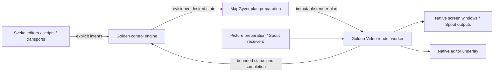

# MapGyver architecture

MapGyver is a video mapping application alongside Chataigne, using the same Golden Core,
workbench, parameter system, scripting, transport, and persistence foundations. Its first target
is Windows x64 (`x86_64-pc-windows-msvc`). The M02 shell/shared-host seams are implemented, and
M03 has introduced Golden Video's compiler, bounded worker runtime, shared Golden Time scheduling
and a D3D11 compositor with bounded Spout inputs and window/Spout outputs. Media/channel
authoring contracts use the shared engine/history/codec and publish guarded channel plans through
an app-owned preparation boundary. Mapping, Matrix and the specialized editors below remain
planned. Execution belongs to the
[MapGyver plan](../plan/MapGyver_Implementation_Plan.md) and its
[status ledger](../progress/mapgyver-status.md).

## Ownership

MapGyver owns media authoring, projection mapping, Matrix behavior, and its four specialized
editors. Golden owns reusable execution and presentation mechanisms.

| Boundary | Responsibility |
| --- | --- |
| `apps/mapgyver/src/app/` | Thin lifecycle/identity/Golden startup; registers media nodes and delegates app operations. New projects include Dashboard and the media authoring container; full manager features remain M04/M05 |
| `apps/mapgyver/src/media/` | Persistent media/channel identity, source/size contracts, atomic backend operations, bounded demanded dependency capture and worker-side channel-plan publication. Expanded media/editor integration continues in M04/M06 |
| `apps/mapgyver/src/screen/` (planned) | Screen/surface definitions, crop/pin/calibration authoring, output policy, backend intents and integration nodes |
| `apps/mapgyver/src/matrix/` (planned) | Cells, layers, groups, columns, transitions, exported channels, app associations and demand policy |
| `apps/mapgyver/ui/` | Svelte 5 Screen, Surface Source, Composition and Matrix editors; app registrations and focused editor stores |
| `crates/golden_video/` | Compiler, bounded worker/null runtime, optional D3D11 compositor and bounded Spout input/window/Spout output mechanisms; app integration and qualification continue in M03 |
| `crates/golden_time/` | Typed monotonic/show/sample coordinates, rational mappings, authority epochs and activation observations; apps own transport policy |
| `crates/golden_assets/` | Persistent asset references/validated locators and bounded CPU preparation with scope/binding fences and consumer-lifetime leases; app catalogs and media integration remain with their owners |
| `packages/golden-video-ui/` | Reusable Svelte preview registration, DOM geometry/clipping, negotiated host transport and installation/retirement covers; no mapping policy |
| Existing Golden Core hosts and Golden UI | Shared desktop/headless startup, native window integration, workbench, inspectors, history, dialogs, generated transport and persistence |

Media, Screen, Surface and Matrix product nodes never live in `golden_*`. Neither Golden Video
nor Golden UI imports MapGyver or Chataigne. MapGyver does not import Chataigne modules or its
Alchemist/state-machine systems. Golden Video follows the independent Golden Audio pattern:
no Tauri, app-node, or mutable engine dependency; Windows/COM/Spout implementation details stay
behind its public contracts. Use existing Golden identity/time/resource contracts where available.

The [render-plan compiler](../../crates/golden_video/README.md) consumes typed texture operations,
checks the full submitted dependency graph and compiles demanded passes without native resources.
Sources declare storage/color/alpha; internal targets use linear premultiplied alpha. Its bounded
logical footprint is not whole-runtime GPU admission: prepared/live/in-flight/retiring resources,
bridge/presentation pools and retained leases must remain charged through their actual lifetime.
The runtime reuses `golden_io` workers, cancellation, revision fences, retained CPU inputs and
retirement pools. One preparation and the latest desired plan feed frame-boundary installation;
reliable outcomes retain admission credits until drained. Worker-local backend resources remain
charged across prepared/live/retiring generations until matching device completion. Control drop
does not join; the host must observe actual retirement before destroying an owned native window.
The core admits the complete baseline before initializing the backend and distinguishes pending,
ready and confirmed-lost stages. Initial `AllocationFailed` results retry with capped background
backoff in the same first device generation; invalid limits, budget rejection and unsupported capabilities
remain terminal. Pending startup still serves time/project intents and retains the latest desired
plan, while preparation and completion service wait for initialized resources. The resource
snapshot's `initialized` flag records first success through later device loss; backend/native
`initialized` observations describe resources currently present. Cancellation wakes waits between
attempts but cannot guarantee interruption of a blocked driver call or early baseline release.
The null backend exercises ownership with simulated allocation/completion. The optional Windows
backend now executes demanded clear/sample/composite passes, all four blend modes and declared
color/alpha conversion on D3D11. Native output pools belong to the device lifetime and reserve a
visible baseline before allocation; generation charges include conversion and compositing scratch
textures. These descriptor-storage charges do not measure opaque driver overhead or residency.
Completion queries are preallocated, and unwind also marks the admitted use before resource drain.
Each configured output retains one endpoint slot and its baseline reservation. Creation/delivery
failure retries that endpoint with bounded backoff while healthy outputs continue. The failed
endpoint remains owned until real renderer completion covers its last attempted batch; destruction
precedes replacement allocation, with no overlapping endpoint pools. Busy or occluded windows
retain their endpoint. Output lifecycle observations and transition notifications expose recovery;
recovery withdraws the old accepted token until the replacement actually accepts a submission.
The [owned host consumer](../../apps/mapgyver/tests/native_video/smoke.rs) composes this public
runtime with Golden's window lifecycle. Bounded Spout inputs now own separate IO/device workers;
prepared/live/retiring generations hold input demand, while bridge readers retire through the
renderer fence and writers through their source-device fence. Admitted maximum extents bound
capture/bridge pools; actual size observations drive backend plan preparation without choosing
app size policy. Source subscriptions now travel atomically with each plan; fixed global
worker/storage capacity covers overlap through retirement, with fresh IDs for changed bindings.
Source-session retirement withdraws publication and invalidates observation guards before waiting
for source-device completion. The worker retains native ownership through that wait; cancellation
or renderer acknowledgment cannot substitute for completion of source-device commands.
The app's `media/rendering/` bridge publishes demanded channel plans through public Golden APIs.
Authoring and source-layout guards survive preparation and installation; project/device stamps
reject stale observations. Source metadata changes wake a preparation worker, not the engine loop.
The owned native channel harness exercises this bridge; the main workbench does not start GPU
work without a host consumer's demand. Golden's generic preview registry/region-blit mechanisms
and reusable UI bindings now exist; specialized app editors and full physical qualification
remain with their app milestones. See the
[runtime/native evidence](../progress/mapgyver-m03-render-foundations.md).

The filesystem sketch above names responsibility boundaries, not a requirement to create one
crate per folder. Keep cohesive app systems in the app crate until an exercised public consumer
justifies a separate crate. Integration nodes belong beside their system in `integration/`.

## Media and channels

The Media Manager contains reusable media definitions. Every media exposes one or more channels;
each channel is a concurrently available video texture with its own extent. Multiple consumers
of the same channel share its rendered resource, rather than re-rendering that media per surface.

| Media type | Initial behavior | Channel ownership |
| --- | --- | --- |
| Solid Color | Authored color/alpha and output size | User-configured channels, with independent settings |
| Picture | Image assets, worker-side decode and GPU upload | User-configured channels, each with its own picture and size policy |
| Shared Texture | Receive Spout textures | One configured sender per channel; all channels receive concurrently |
| Composition | Ordered 2D instances of other media channels | Authored output canvas/channel definitions; one output by default |
| Matrix | Resolume-style cells, layers, nested groups, transitions and blend modes | Automatically derived channels for layers, groups and final composition |

Spout channels are independent receivers, **not** alternatives in a fallback list. Selecting a
sender for one channel never replaces another channel's sender. Sender discovery is runtime
metadata; persist the configured sender name/selector, not a native sharing handle.

A source reference is the typed pair `(MediaId, ChannelId)`. Channel IDs remain stable through
rename, reorder, size changes, disconnect/reconnect, and resource recreation. Array indices and
labels are never identities. Matrix channels derive their persistent identity from the owning
layer/group/final-output identity. Removing a channel leaves an explicit missing reference;
consumers never silently switch to another channel. Undo/reload restores the authored identity.

The implemented M03 foundation uses Golden node UUIDs wrapped as app-owned `MediaId` and
`ChannelId`. A media and each channel are separate nodes, so a channel edit captures that leaf's
authored data instead of cloning the catalog. `mapgyver.media.edit` accepts Rust-owned intents
through `ProjectLifecycle::apply_app_operation`; the shared atomic transaction/history boundary
also serves QuickJS `gc.invokeAppOperation` and headless callers. Creation uses one detached
media/channel subtree. Labels, initial channel settings and size defaults are backend policy.
New projects expose the authoring container and M04's controls/commands/script methods/templates.
The media contract now includes Solid Color, Shared Texture, Picture and Composition authoring;
Matrix joins with M07. Composition instance editing stays under `media/composition`, using the
same `mapgyver.media.edit` operation, module commands, hosted methods and committed callbacks.

`media/protocol.rs` generates TypeScript into the app UI, including Golden Video's canonical
descriptor/filter types. `media/resolution.rs` keeps source availability separate from resolved
extent: Automatic may remain unresolved, while Fixed retains its extent during source loss.
The initial backend canvas is 1920×1080; dimensions are nonzero and at most 16384 texels per
axis. Shared Texture defaults to an unconfigured exact selector and explicit BGRA8/sRGB/straight
alpha with that maximum extent. Runtime admission can impose lower budgets. Runtime source
observations are not project data. `media/capture.rs` copies only demanded authored dependencies after
transaction settlement. Manager-instance, membership and channel revision guards invalidate old
captures on edits, removal, history and reload, including nodes retained by history. These clocks
are runtime-only. `media/rendering/` runs on a host/preparation worker and publishes immutable
plans with those guards. Multiple consumers share one channel target; changing a Spout contract
allocates a fresh runtime binding without changing persistent channel IDs.

Automatic channels without source metadata remain unresolved. Source-only demand warms the
receiver while consumers receive a transparent 1×1 GPU placeholder; that placeholder is never
reported as the channel's resolved extent. Missing, disabled, unconfigured and unavailable states
remain explicit. Source-layout/session/pool guards fence resize/replacement across installation.
Availability changes trigger preparation notifications without invalidating layout alone, allowing
receiver warmup; native missing-source handling supplies zero storage during subsequent loss.

Each channel has an authored size policy, either `Automatic` or `Fixed { width, height }`, and a
separate observed resolved extent/status. Automatic uses picture/Spout source metadata, an
authored composition canvas, or the Matrix canvas for derived Matrix outputs. A source without
an intrinsic extent uses an explicit backend default; Solid Color starts with a backend-defined
canvas extent. An absent source is unresolved, not a zero-sized texture. Fixed sizes resample the
source using a declared fit/filter policy. Validate finite dimensions, device limits and memory
budgets before allocation. Source resizing changes the resource generation, not the channel ID.

Composition instances reference media channels without taking ownership of their media. Each
instance has position, scale, rotation, pivot, opacity, blend mode and draw order. Moving or
duplicating an instance does not duplicate its source. Cropping for a Surface belongs to that
Surface, not to the shared source. Composition and Matrix dependencies form a directed acyclic
graph: reject direct or indirect feedback, including a Matrix cell referencing that Matrix's
own exported output. Removing dependencies and undo/redo use the same validation boundary.

Composition instances are separate UUID-backed child nodes under their output channel, ordered by
document sibling order. Inspecting the media catalog does not copy their definitions; use the
Composition inspect operation for that document. Instance position locates its pivot in logical
canvas texels; scale is relative to source size, pivot is a source fraction, and rotation is radians
in the canvas plane. Opacity and the four canonical Golden blend modes are authored per instance.
Fixed output resolution preserves the logical canvas layout. Resizing the canvas leaves existing
instance coordinates unchanged; AddInstances explicitly centers new source instances in the canvas.
Node factories retain context-free defaults so sparse saving never drops contextual placement.

Add/copy batches admit at most 4,096 instances and insert one detached forest; each output admits
100,000 authored instances. Labels are reserved once per batch. Source binding checks and iterative
dependency validation run on edits/load, with no recursive walk or frame-loop polling. Missing
references remain authored; transform edits do not rebind them. Matrix dependency edges still join
with M07. Capture now expands active Composition instance dependencies with bounded channel and
instance admission, retaining guards for visited instances including disabled entries. The preparation
worker orders the demanded DAG and builds one shared target per channel. Independent transforms
map source texels around source-fraction pivots into logical canvas coordinates; output resizing
does not rewrite the layout. Positive rotation is clockwise in the downward-Y canvas. Existing
Golden projective layers own sampling, opacity and blending. Missing inputs are skipped while
unavailable Spout inputs retain source-only demand for recovery. Instance/dependency/guard budget
rejection leaves that Composition unavailable and prunes otherwise-undemanded IO/passes. Renderer
budgets remain unchanged. Software mapping checks and a native submission/lifetime smoke pass;
full native pixel/preview correctness and complete Composition editor acceptance remain M06 work.

Movie-file playback, audio, effects/plugin hosting, mesh warping and edge blending are not part
of this initial feature list. Add them as explicit later scope rather than assuming that
"video mapping" implies a decoder or audio transport in the first delivery.

## Control and rendering



The engine owns authored state, validation, atomic edits, history and coordination. Worker-side
preparation resolves media dependencies and assets, validates the GPU resource budget, and
compiles a revisioned render DAG. The renderer owns GPU resources and frame cadence. No image
decode, GPU wait, Spout discovery, process launch, or per-frame polling runs in engine callbacks.
Windows UI/COM operations stay on their required host thread; rendering never blocks its message
pump waiting for a frame or worker cleanup.

Golden Video consumes generic passes: clear/fill, sampled textured quad, affine composition,
projective quad, blend, offscreen target and output presentation. It does not consume Matrix
columns or MapGyver nodes. A changed parameter or dependency invalidates affected preparation;
do not rebuild the entire engine snapshot or every media output on each frame or pointer move.

Start with a private D3D11 backend, using maintained Windows bindings and a vetted upstream
Spout SDK binding. This is the recommended Windows-first design, subject to the native spike;
it is not a commitment to a second cross-platform backend or an abstract universal graphics API.
Spout's native D3D11 texture API avoids adding D3D12/Vulkan sharing as an initial prerequisite.
The rationale and primary sources are in [native rendering research](mapgyver-native-rendering.md).

The native path must avoid recurring CPU readback/upload. GPU copies, format conversion and
one-time picture uploads are valid and measured. Start on one explicitly identified render
adapter; report incompatible senders/outputs instead of silently moving one receiver to another
device. Cross-adapter support needs separate qualification.

Use explicit pixel format, color-space and alpha contracts. Proposed initial contract: BGRA8/RGBA8
sources, linear-light compositing with premultiplied internal alpha, and explicit input/output
conversion; do not infer a sender's alpha convention from its DXGI format. Qualify normal,
add, multiply and screen blend equations, alpha edges and picture/Spout parity before expanding
the supported format set. HDR and wide-gamut output are later scope.

Plans and completions carry project epoch, plan revision and resource generation. Install
prepared generations at a frame boundary; old GPU resources retire only after their final use
completes. Coalesce superseded desired plans, while retaining reliable command outcomes and
unload completion. Bound in-flight preparation, textures, preview registrations, events and
retiring generations; rejected admission returns an explicit error without partial live changes.

Use the reusable monotonic production-time boundary for transitions and scheduled activation.
Monitor presentation rates and sender arrival do not define show time. A slow output must not
stall all outputs or the control engine. Independent displays are not implicitly genlocked.
`golden_time::TimeAuthority` supplies immutable show mappings and discontinuity epochs. The video
worker schedules from absolute rational frame deadlines and samples this authority once per
submission for all consumers; reader projections do not advance effects. Replacement authorities
have distinct identities even at generation zero. This is shared P14 foundation evidence;
Chataigne's audio/DMX integration and synchronization acceptance remain open.
[`golden_assets`](../../crates/golden_assets/README.md) now supplies P15's shared UUID/locator,
scope/binding-fence and bounded CPU-preparation foundation. Apps keep authored catalogs and
collect/relink/history policy. File resolution/hash/decode run on its worker; prepared leases
retain admission through every consumer and off-thread final destruction. The public synthetic
Video consumer forwards its guards into actual null-runtime installation. MapGyver Picture,
project/history and GPU-upload integration now use this same boundary. Chataigne's audio/P15
acceptance remains open.

`media/assets.rs` owns catalog nodes alongside media definitions. An asset reuses its node UUID
as its `AssetId`; only the source locator is authored node data. Import/relink/remove/inspect
use the same atomic backend intent/history route as channels. A removed asset leaves explicit
missing references; undo/reload restores its ID. Demanded-leaf capture copies only referenced
asset records and ownership guards. No filesystem access runs on the engine owner.

`media/picture/` owns PNG/JPEG codecs and demanded preparation. Initial support is static SDR8,
with EXIF orientation and tightly packed sRGB/straight-alpha RGBA. Untagged files assume sRGB;
explicit unsupported profiles, APNG and 16-bit PNG fail visibly. Codec quotas/dimension checks
are declared allocation admission, not allocator/OS-memory measurements. Golden owns source
staging, cancellation and retained leases; Video owns worker-local GPU upload and retirement.
Multiple channels share a prepared asset/upload while retaining independent output targets/sizes.

Hosts configure Picture preparation with an explicit project directory and budgets. Completion
notifications and coarse one-second missing/IO/capacity retries run through the preparation owner;
they do not poll the engine. File-change callbacks can retry one asset without invalidating
healthy sources. Relocation invalidates the appropriate runtime scopes; source bytes, fingerprints
and GPU handles remain absent from project/control JSON. Ready-file watching and dedicated manager
controls/commands/callbacks/snippets remain M04 work. The default workbench still creates no GPU
renderer without a native consumer's demand.

## Screens and surfaces

The Screen Manager supports any number of authored screens, subject to explicit runtime GPU
and output capacity. Each Screen has an output extent, ordered Surfaces, and one typed target:

| Output target | Coordinate and lifecycle contract |
| --- | --- |
| Display fullscreen | Configured display identity, borderless native window, physical display-pixel output, per-monitor DPI correction |
| Desktop rectangle | Global physical desktop `x/y/width/height`, including negative origins; no assumed global DPI scale |
| Virtual Spout | Authored sender identity and extent, offscreen rendering with no output window |

Host code enumerates displays and manages native window lifecycle; Golden Video presents the
rendered texture. MapGyver owns which screen targets which endpoint. Preserve the selected
display across enumeration reorder; a disconnected display becomes unavailable and is retried
when it returns. Never silently project onto the primary monitor. Validate sender-name
collisions before activating virtual outputs and report/recover from sender loss or device reset.

A Surface references one `(MediaId, ChannelId)` and contains:

- A normalized source crop rectangle in that channel's full image, independent of current
  resolution. The backend rejects nonfinite, empty or out-of-range crops.
- Four ordered destination corner pins in normalized Screen coordinates. The backend validates
  a finite, convex, nondegenerate quad and computes the projective homography. Use perspective
  sampling, not two independently affine triangles with a visible diagonal seam.
- Draw order, visibility, opacity and a calibration override. A simple initial overlap rule is
  normal alpha-over in Surface order; changing source never changes geometry.

Crop the source, map the resulting rectangle through the homography, then composite into the
Screen. The automatically sized calibration pattern replaces the sampled source within this same
path. It is generated without an external media asset and remains usable while a source is
missing. Include a grid, border, corner labels and orientation markers. Leaving calibration
restores the original source/crop; calibration never overwrites that reference.

Display physical pixels, CSS client coordinates, native client pixels, normalized source UV and
normalized destination coordinates are distinct types. Native output rectangles and texture
extents are intentional pixel-valued domain data; UI layout/spacing still uses relative units.

## Matrix and app lifecycle

Matrix is a media type and an authoring system, not a separate renderer. Rows/layers contain
media-channel cells; columns launch a coordinated set of cells. Groups form a tree with stable
membership and ordering. The backend resolves cells, empty-cell behavior, transition curves and
durations, blend modes and output export policy. Proposed initial empty-cell behavior is to
transition the layer to transparent; expose the policy explicitly before adding alternatives.
Editing/selection in the Matrix editor is distinct from an explicit column load/launch intent.

During a transition, incoming and outgoing media remain demanded. Layer/group/final channels
render from the same plan and are independently routable to Surfaces or other media. Exported
channels do not require an additional complete Matrix render for every consumer.

Columns can reference app definitions with stable IDs, executable, argument vector, working
directory, readiness and stop/restart policies. Multiple columns may share an app definition.
MapGyver computes app demand; a generic Golden IO owned-process service handles OS resources.
Do not copy or path-import Chataigne's private App Control implementation.

Preloading and postloading are **column distances**, confirmed by the user. For app-bearing
column `j`, with `pre_j` and `post_j`, a loading/current column cursor `i` creates neighbor demand
when:

```text
j - pre_j <= i <= j + post_j
```

Thus column 3 with `pre=1` starts its app while column 2 loads; `post=1` retains it through
column 4. Clamp at Matrix boundaries; do not wrap. A direct jump evaluates the destination
window without launching every skipped column. These are logical column distances, not time
delays. Independent launch scopes and overlapping transitions contribute a union of demands.

App lifetime is the aggregate of neighbor, preparation, active-cell and outgoing-transition
leases. Start on first demand, resolve readiness separately from process creation, and release
only after the last lease and final render/unload completion. Neighbor preload can prepare an
app without displaying its column. Readiness can require the configured Spout sender/first frame
with a timeout; a running process alone does not prove its texture is ready.

On final release, request graceful shutdown and then terminate the owned process tree after the
configured deadline. Windows Job Objects provide tree ownership and kill-on-close. Launch
suspended, assign the job, then resume to prevent a child-creation race. Never kill processes by
executable name or attach ownership implicitly to a pre-existing external instance. Elevated
targets, singleton handoffs, launchers and breakaway processes need explicit detected outcomes;
"any app" means configurable executable targets, not a guarantee that Windows permits ownership
of every process.

Process exit while demand remains triggers bounded background restart/backoff. Intentional
unload cancels retry. Reorder/delete/configuration changes reconcile leases atomically, and
generation fencing rejects late starts/readiness from old projects. Process launch/stop effects
are not undone by rolling back an authored transaction: dispatch only after validated demand
commit and report outcomes explicitly. Project replacement/shutdown retire old app ownership
without a main-thread join.

## UI, protocol and persistence

Register app panels using Golden UI's public workbench/inspector/outliner hooks:

| Editor | Interaction |
| --- | --- |
| Screen | Select/arrange Surfaces, drag four pins over native Screen preview, toggle calibration |
| Surface Source | Preview the full source channel, edit its crop rectangle |
| Composition | Arrange, scale, rotate, order and blend media-channel instances |
| Matrix | Virtualized layer/group/column grid, cell source assignment, launch state, transitions and app/pre/post settings |

Keep media catalog, screen state, Matrix state and native preview bindings in focused stores;
reuse Golden transport/session abstractions. Svelte collects gestures and uses transient visual
feedback; backend intents own defaults, naming, validation, graph edits, crop/pin legality,
channel allocation and Matrix/app semantics. A gesture becomes one coherent history operation;
do not create a history entry per frame or implement a second rule engine in TypeScript.

The app-owned `ui/src/lib/composition/` panel/controller/forms expose Composition channel selection,
searchable source assignment, ordered instance creation/copy/rename/reorder/removal, transform and
blend controls, canvas settings and the existing native channel preview. Backend `CompositionEdit`
operations own all authored behavior. UI selection/read/mutation state is fenced by session and
project generation, with exclusive submissions and event-driven inspection for history/script edits.
Closing the panel disposes its controller and preview registration. Instance rows are paged at 50;
source search displays at most 100 matches plus the retained selection. Picker values retain exact
IDs through catalog changes, including explicitly missing authored sources.

Composition graphical selection/translation/rotation/scale uses `EditInstanceGeometry`: the UI
sends the original authored transform and canvas-texel pointer start/current positions. Rust computes
translation, signed angular change and scale along the original local axes, preserving current
unrelated fields and rejecting invalid samples before commit. Its coalesced self-data callback
returns one authoritative instance patch and retains initial/final state in an explicit edit group.
The UI draws source outlines from renderer-reported resolved extents, not inferred source defaults;
missing metadata still permits pivot/gizmo editing. At most 128 regular outlines/pivots plus the
selected instance are mounted; the list provides access to the complete document.

`golden_ui/store/latest-edit-gesture` owns the app-neutral bounded group/request lifecycle shared
by Surface and Composition adapters: one in-flight sample plus one latest sample, revision/session
fencing, drain on release and discard of unsent work on cancellation/closure. App adapters own
typed intents, backend geometry and authoritative patches. Other authoring controls and catalog
inspection defer during the shared group. Escape preserves accepted edits as one Undo group.
Software geometry/history/script tests and bundled checks pass; real editor input and complete
native preview/output pixels remain unverified. A bounded desktop attempt displayed the ordinary
Composition panel but encountered a reported Windows integrity limit and no visible click result.

The Screen and Surface Source editors send `EditSurfaceGeometry` with the Surface identity and
a generated quad-corner, crop-corner or crop-origin intent. MapGyver reads the current definition
and validates the result, preserving every field outside that intent. Crop corners keep the
opposite corner fixed; crop-origin changes preserve width/height. Crossed, empty, non-finite and
out-of-source crops fail atomically. The full-source preview registers the assigned channel
directly, independent of the cropped/warped Screen output and calibration. Missing references
remain authored and unavailable; no other channel is substituted.
The independently dockable Screen Manager and Surface Source panels share a window-scoped
authoring context: one catalog, selection, inspection stream and gesture controller. Closing all
editor views stops inspection and finalizes accepted input; output demand remains independent.
The UI keeps one request in flight and one latest point,
patches the authoritative Surface reply, and suspends catalog refresh until the gesture ends.
Golden's explicit coalesced callback edit retains original/final authored state for adjacent,
contiguous changes to the same node inside one edit session. Other edits remain history barriers;
callbacks and live publications still run for each accepted sample. Self-data-only callbacks opt
out of reference/context rescans, with metadata changes still invalidating conservatively.
Pointer cancellation or editor closure discards unsent input and finalizes accepted changes as
one undoable gesture. It does not roll back accepted edits automatically. Project/session changes
fence stale replies; the existing session owner handles transport loss and closes accepted work.

The native preview uses transparent regions in the WebView over one native GPU underlay per
editor window, with DOM/SVG interaction handles above it. Golden Video's `preview/` owns the
Rust-generated negotiation/layout/status contract and bounded coalesced session leases.
`packages/golden-video-ui` supplies `NativePreview`, a window-scoped session and desktop transport,
CSS rectangle/ancestor clipping measurement, heartbeat/reconnect and opaque covers while native
installation is pending. App routing resolves opaque source keys into app channels; Golden owns
no channel defaults, graph edits or mapping behavior.

The shared `NativePresentation::with_control` extension exposes the bounded metadata-only
`native_presentation_control` command for its retained window. Its UI callback queries actual
client/WebView bounds, BoundsMode, rasterization and HTML zoom, converting CSS to physical pixels
once. The worker projects clipped normalized regions onto the admitted backing. New layouts
coalesce, and an invalidated visibility guard clears the active target without waiting for a new
resource allocation. The next installed region plan draws the current views. Removed DOM
components keep bounded opaque retirement masks until that clear is acknowledged; measured masks
use CSS-pixel placement while ordinary product layout keeps relative units. Full frames, render
graphs and native texture handles never travel through this control protocol.

Layout acceptance does not uncover a preview. The native owner first verifies a reliable plan
installation and a matching submitted frame, then acknowledges the current geometry generation;
stale acknowledgements cannot revive a replacement layout. This asynchronous handshake does not
claim frame-atomic DOM/native movement, physical alignment or scanout. The owned shared-host/Svelte
fixture lives at `apps/mapgyver/tests/native_preview/`; full display/DPI/input qualification and
the four specialized editors remain at their planned app milestones.

Treat native preview as a negotiated host capability. Browser sessions retain control/editing
with truthful preview availability; remote video streaming is a separate future adapter.
Native screen outputs remain active when the editor is minimized or disconnected. See the
[research and spike criteria](mapgyver-native-rendering.md) for DPI, layering and input details.

Use the existing domain-neutral application-operation envelope. MapGyver Rust DTOs own requests,
responses, observations and versions; generate TypeScript from them in the same change.
Golden Video's reusable DTOs belong to its own public contract. Keep GPU handles, process handles,
frame pixels, render graphs and platform API types out of the wire schema.

Persist media/channel IDs, asset references, composition instances, Matrix definitions and app
associations, screens, targets, surfaces, crops and pins. Persist size intent separately from
runtime size/status. Runtime process IDs, sender handles, current textures and in-flight
transitions are not project data. Opening/restoring an authored project does not itself count
as an explicit column launch. Asset identity, relocation/relinking, codecs and migrations use
the reusable persistence/resource boundary; file dialogs stay in the host.

Every manager/module ships its command nodes, script-callable methods, callbacks and app-owned
script snippets together. Cover media/channel create/remove/configure, source assignment,
composition edits, Screen/Surface creation and targeting, crop/pin/calibration, Matrix launches
and app configuration. Scripts, UI, HTTP/WebSocket and headless callers share the same intents
and authoritative receipts; runtime readiness/failure/finished-unload callbacks describe effects.

## Scale and recovery

Batch known detached structures with `NodeTree`/`AddNodeTree`. Matrix cells and channel references
must not become a quadratic set of subscriptions or trigger full-tree publication per cell.
Keep preparation proportional to changed dependencies, preview work proportional to visible
regions, and rendered pixels proportional to demanded outputs. Do not allocate textures for
every inactive cell or every possible Matrix export eagerly.

Report authored nodes, media, channels, cells, active passes, rendered pixels, GPU memory,
preview count and output count separately. Provisional reference qualification includes 1080p60,
4K output, multiple independently sized channels and simultaneous display/Spout outputs; record
hardware, formats and scene complexity before fixing pass/fail timing budgets. Node-count
capacity is not evidence of GPU/pixel throughput.

Sender disappearance/replacement/resize, display hotplug, device removal, asset replacement,
process crash and host teardown each have explicit states and background recovery. Source loss
initially renders transparent with an unavailable status; optional hold-last-frame behavior must
be explicit. Retain stable references, rebuild dependent views/resources after device reset,
and reject stale completions. Verify teardown, repeated load/unload and memory/handle bounds
alongside successful frames; the renderer must keep serving healthy independent outputs.

An endpoint error does not authorize device-wide resource discard: the native device must report
removal. Output retries reset their backoff after actual API acceptance, and quiescing cancels
future retries. Clock intents do not clear unrelated runtime faults; recovery is reported when
service resumes. The M03 recovery gate remains open for genuine device-removal qualification and
finite bounds for stuck source/driver drains.
Immediate source withdrawal protects visibility and stale-plan fences while those drains retain
ownership; it does not establish that cleanup has completed.
